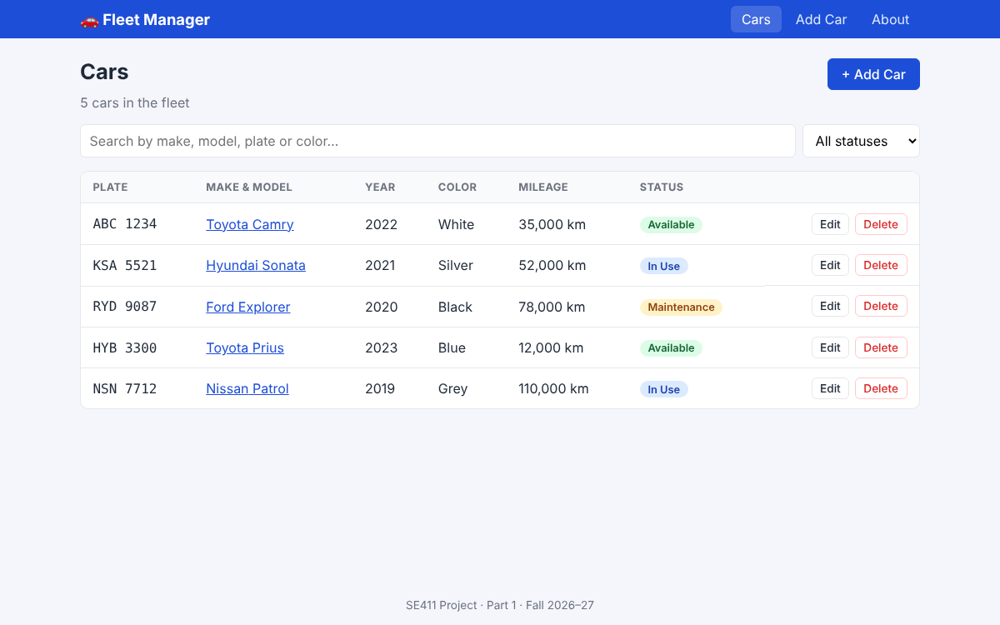

# Fleet Manager – SE411 Project (Part 1)

A React application for managing a company's **cars**: add, display, update and delete cars, with
search, filtering and an About page. In Part 1 the data is kept in memory (no database).



## Team

| Name                | Student ID |
| ------------------- | ---------- |
| Reema Alnasser      | 223410003  |
| Sarah Almuhaini     | 222511391  |
| Aljoharah Alqahtani | 221511429  |

## Getting started

Requirements: [Node.js](https://nodejs.org/) 20 or newer.

```bash
git clone https://github.com/ReemaAlnasser/SE411-PhaseOne.git
cd SE411-PhaseOne
npm install
npm run dev        # open http://localhost:5173
```

| Command         | Description                    |
| --------------- | ------------------------------ |
| `npm run dev`   | Start the development server   |
| `npm test`      | Run the automated tests        |
| `npm run build` | Build for production (`dist/`) |

## Features

- Navigation menu (Cars · Add Car · About)
- List all cars, view a car's details
- Add and edit cars with form validation
- Delete cars with confirmation
- Search and filter by status
- About page with team members

## Documentation

- [Requirements](docs/requirements.md)
- [Architecture, tech stack and features](docs/architecture.md)

## Tech stack

React 18 · Vite 6 · React Router 6 · Vitest + React Testing Library
